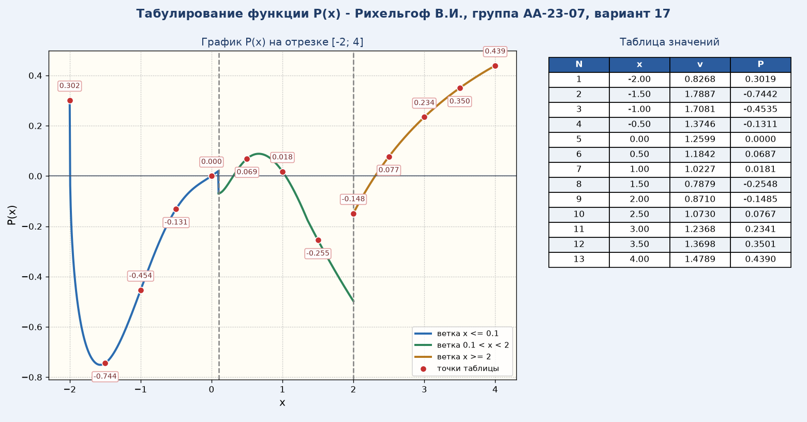
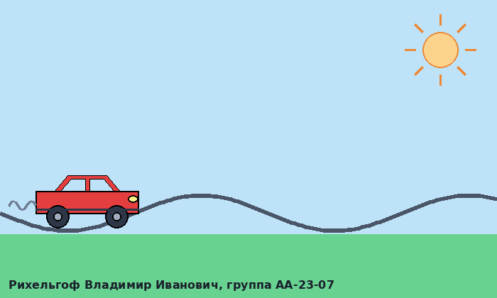
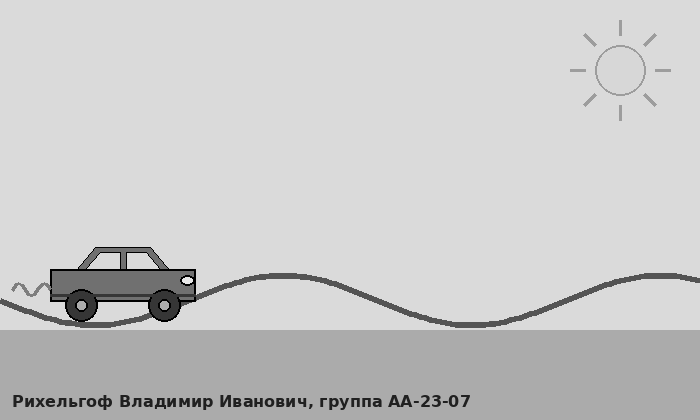
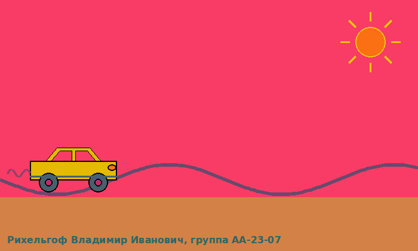
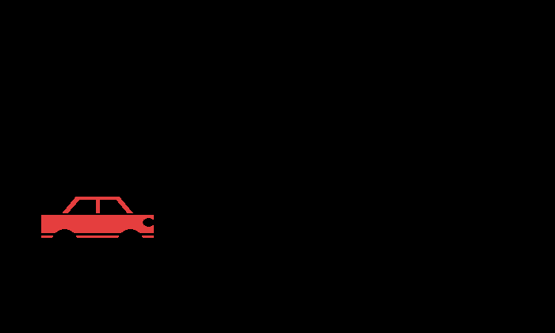

# График функции, анимация на Tkinter и обработка картинки в OpenCV

Вторая лабораторная по информатике, вариант 17. Три задания, каждое в своём файле.

## 1. Табулирование функции

[task1_tabulation_plot.py](task1_tabulation_plot.py)

Считает P = min(x, a) * ln(v) / (корень 5 степени из |v - 4|) при a = 1.35 на отрезке от -2 до 4 с шагом 0.5. Функция v(x) задана по-разному на трёх участках. Программа печатает таблицу в консоль ([вот так](results/table_output.txt)) и рисует график в matplotlib, где каждый участок своим цветом, а рядом таблица значений.



## 2. Машинка на Canvas

[task2_car_animation.py](task2_car_animation.py)

Машинка из примитивов Tkinter едет по волнистой дороге и разворачивается у краёв окна. Есть кнопки «Нарисовать», «Движение/Стоп» и «Сохранить рисунок». Canvas нельзя напрямую сохранить в png, поэтому картинка дополнительно рисуется через Pillow, она нужна для третьего задания.



## 3. Цветовая маска в OpenCV

[task3_hsv_color_mask.py](task3_hsv_color_mask.py)

Берёт рисунок из второго задания, переводит его в оттенки серого и в HSV, а потом по диапазону, который задаётся ползунками, строит маску и вырезает нужный цвет. По умолчанию выделяется красный кузов машинки. Клавиша s сохраняет результат, q или Esc сохраняет и закрывает окно.

| Серый | HSV | Маска | Результат |
|---|---|---|---|
|  |  |  |  |

## Запуск

```
pip install -r requirements.txt
python task1_tabulation_plot.py
python task2_car_animation.py
python task3_hsv_color_mask.py
```

Третье задание запускать после второго (нужно нажать «Нарисовать»). Все картинки и файлы сохраняются в папку results.

---

Учебная работа, РГУ нефти и газа им. Губкина
